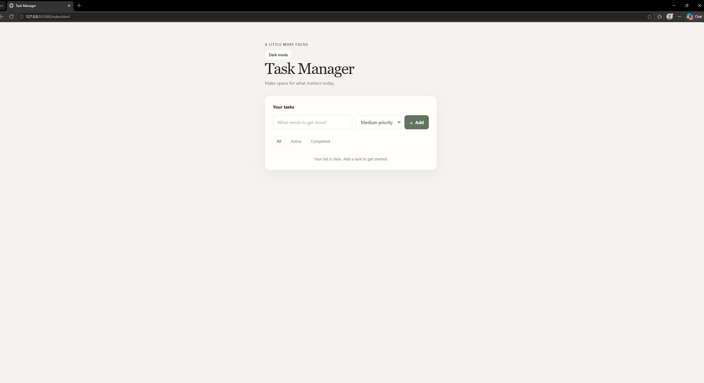
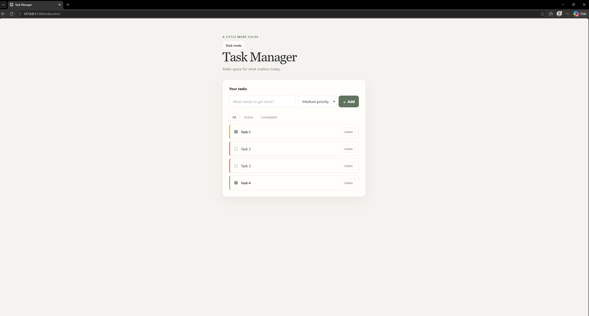

# Task Manager

A lightweight task manager built with plain HTML, CSS, and JavaScript. Add, organize, and track tasks in a clean interface, with task and theme preferences saved in your browser.

## Technologies Used

- HTML5
- CSS3
- JavaScript
- `localStorage` for saving tasks and the selected theme
- Built with GitHub Copilot assistance

## Features

- Add tasks with the **Add** button or Enter; blank tasks are rejected.
- Mark tasks complete with a checkbox and strikethrough styling.
- Delete tasks.
- Double-click a task to edit its text.
- Choose Low, Medium, or High priority, shown with a color-coded left border.
- Filter tasks by All, Active, or Completed.
- Toggle dark mode; the choice is remembered in `localStorage`.
- Save tasks in `localStorage` so they persist after refreshing the page.

## Installation

Clone the repository:

```bash
git clone https://github.com/camraz88/Assignment3_ModernTechnologies.git
cd Assignment3_ModernTechnologies
```

Open `index.html` in a browser. No dependencies or setup are required.

## Usage

1. Type a task, choose its priority, and select **Add** or press Enter.
2. Check a task's checkbox to mark it complete.
3. Double-click a task's text to edit it, then press Enter to save.
4. Choose **All**, **Active**, or **Completed** to filter the list.
5. Select **Delete** beside a task to remove it.
6. Use the **Dark mode** button in the header to switch themes. Your theme and tasks are saved in the browser.

## Screenshots





## Built with AI

I planned my prompts with Claude and built the app with GitHub Copilot in VS Code using Agent mode.
